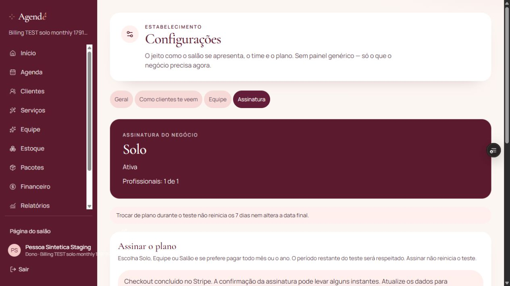
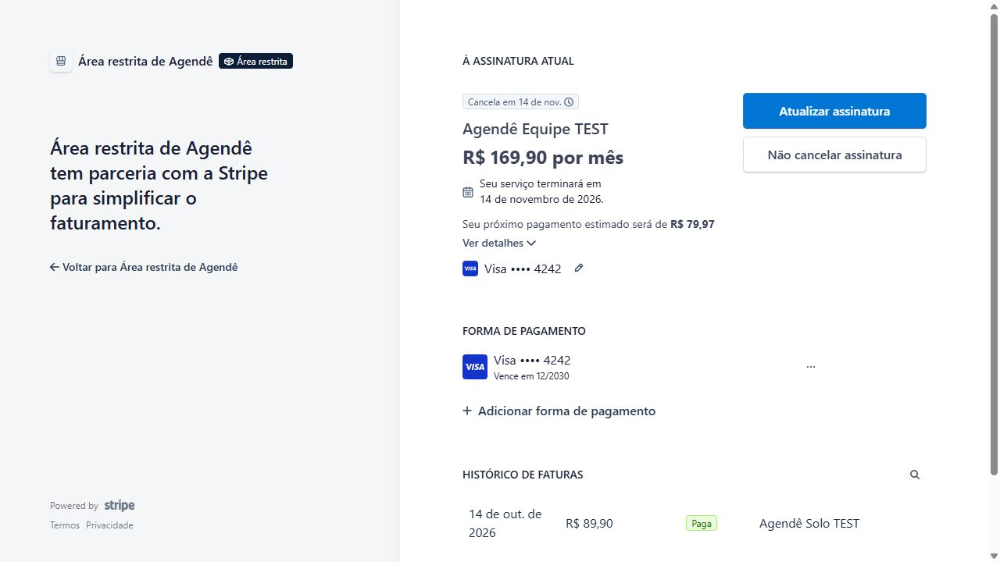
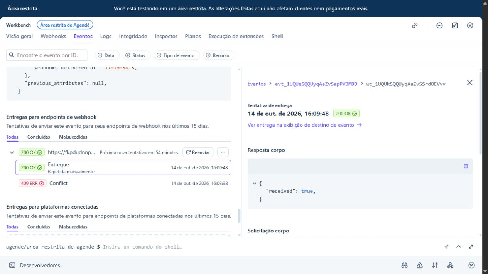

# Homologação integrada Stripe TEST — 14/10/2026

**PASS no staging. NO-GO para lançamento comercial enquanto os critérios produtivos e de Auth permanecerem pendentes.**

Supabase: `fkpdudnnperufnmdwdlv`. Stripe sandbox: `acct_1UPNGJQQUyqAaZvS` (Área restrita de Agendê). Todas as sessões, assinaturas, faturas, cartões e relógios deste ensaio são TEST. Nenhuma credencial foi exportada do Vault; nenhum preço comercial foi alterado; nenhuma cobrança LIVE, migration ou configuração produtiva foi executada.

## Seis preços

Cada linha passou por Checkout criado pela Edge Function com a chave restrita do Vault, pagamento no navegador com cartão sintético, webhook assinado entregue pela Stripe, vínculo persistido e ativação do acesso no Supabase. A repetição da criação reutilizou a sessão aberta. Portal foi criado pela aplicação nos seis casos.

| Plano | Preço | Checkout / pagamento / webhook / ativação |
| --- | --- | --- |
| Solo mensal | R$ 89,90 | PASS |
| Solo anual | R$ 799,00 | PASS |
| Equipe até 5 mensal | R$ 169,90 | PASS |
| Equipe até 5 anual | R$ 1.499,00 | PASS |
| Salão até 15 mensal | R$ 299,90 | PASS |
| Salão até 15 anual | R$ 2.799,00 | PASS |

Identificadores de sessão, assinatura, estabelecimento sintético e valores estão em `billing-integrated-acceptance-2026-10-14.json`. O estado final não precisa continuar ativo: Solo mensal foi usado para upgrade e cancelamento; Equipe mensal foi usado para renovação recusada. Ambos ativaram corretamente antes desses testes.

## Ciclos reais adicionais

| Caso | Resultado / evidência |
| --- | --- |
| Chave restrita acessível | PASS. Operações reais de Customers, Prices, Checkout Sessions, Subscriptions e Customer Portal funcionaram. Nenhuma permissão adicional exigida. |
| Portal no navegador | PASS. Sessão mostra plano TEST, cartão sintético e fatura paga. Link expirado foi recusado; nova sessão foi gerada pela aplicação. |
| Upgrade Solo → Equipe | PASS. Portal alterou preço; webhook atualizou Supabase de Solo/1 para Equipe/5. Metadata antiga não substituiu o preço atual. |
| Cancelamento no Portal | PASS. Acesso mantido durante o período pago; relógio Stripe TEST avançado além do término. Stripe e Supabase terminaram em `canceled`, acesso falso e gravação pelo gestor recusada. |
| Renovação | PASS. Relógio associado ao cliente do Checkout real gerou fatura TEST paga de R$ 169,90 e estendeu o período no Supabase até dezembro. |
| Recusa no primeiro Checkout | PASS. Cartão de recusa apresentou erro, sem vínculo de assinatura nem acesso. Repetição com cartão de sucesso ativou Solo anual. |
| Recusa na renovação | PASS. Cartão TEST que aceita cadastro e recusa cobrança foi salvo pelo Portal. Próximo ciclo gerou `invoice.payment_failed`; Stripe/Supabase `past_due`, acesso falso e gravação recusada. |
| Ordem de entrega e recuperação | PASS. Eventos de criação/fatura anteriores ao vínculo receberam 409 e retry programado. Reenvio real pelo Workbench após Checkout recebeu 200. Os oito eventos inicialmente pendentes foram recuperados; não foi injetado webhook sintético. |
| Idempotência | PASS. Mesmo `invoice.paid` reenviado duas vezes deixou uma linha em `billing_events`. Fatura antiga reenviada após inadimplência não restaurou acesso nem período antigo. |
| Limites pagos 1 / 5 / 15 | PASS. Convites e aceites autenticados atingiram o limite de cada plano; convite excedente retornou `plan_professional_limit_reached`. |
| Isolamento e permissões | PASS nos seis estabelecimentos. Proprietário externo não leu assinatura/financeiro nem gravou serviços. Gestor ativo gravou serviço real; gestor inadimplente/cancelado foi recusado. |
| Interface → Checkout → retorno | PASS adicional em Solo mensal. Pagamento iniciado pelo botão do Agendê voltou autenticado ao Preview com “Ativa”; abertura e retorno do Portal também funcionaram. |

Renovação e cancelamento usam relógios do próprio sandbox com os clientes criados pelo Checkout. Datas futuras são tempo de teste; não representam recebimento ou passagem real de meses. Contas de limite de profissionais são fixtures SQL confirmadas, não evidência de confirmação de e-mail. Upgrade/cancelamento/renovação foram executados em casos representativos; a matriz de seis preços comprova os seis pagamentos iniciais e ativações, não todas as combinações possíveis de troca.

## Correções e validação

O SDK enviava `appInfo.name: "Agendê"`; a Stripe respondia HTTP 400 genérico antes de criar o cliente. Trocar esse identificador técnico por ASCII `Agende` resolveu o erro real. A marca exibida ao usuário continua Agendê. A Edge agora informa apenas operação e motivo seguros para falhas de permissão/provedor. O diagnóstico temporário que retornava mensagem do provedor foi removido.

`stripe-billing` staging está na versão 9; `stripe-webhook` staging na versão 3. O segredo `AGENDE_SITE_URL` do staging foi corrigido de localhost para `https://agende-7ixgp4pxw-pedros-projects-cfddfd39.vercel.app`, Preview existente ligado ao staging. Os seis Checkouts iniciais ainda tinham retorno localhost e falharam nesse retorno; o ensaio adicional pela interface comprovou a origem corrigida. Não considerar essa URL efêmera uma origem definitiva de lançamento.

Nova branch `codex/stripe-test-homologation-2026-10-14` parte da main após merge humano do PR44 (`f2a890b`) e incorpora integralmente a identidade visual do PR45 (`efabcbf`). O único conflito foi o receipt gerado de testes, regenerado com todos os casos. Overrides exclusivos de Preview fixam URL e chave pública do Supabase staging, além da origem de teste. Nenhuma variável de Production foi alterada.

Validação após incorporar PR45: **304 testes de aplicação PASS**, incluindo 16 testes Stripe com mocks explicitamente identificados; lint dos novos executores e regressões PASS. Os testes reais acima são evidências separadas dos mocks. Executores `staging-billing-verification.mjs` e `staging-billing-seats.mjs` exigem opt-in explícito e URL exata de staging. O segundo exige as 14 fixtures sintéticas preparadas neste ensaio; não deve ser usado em produção.

Receipts anteriores `billing-first-configured-key-attempt.json`, `billing-key-diagnostic.json` e `billing-application-acceptance.json` preservam tentativas e a etapa anterior a pagamentos. O receipt integrado é o estado final; não reclassificar o HTTP 400 histórico como falha de permissão.

## Pendências para lançamento

| Estado | Pendência | Ação e comprovação |
| --- | --- | --- |
| BLOQUEADO | Backup recuperável de produção sem senha válida | Proprietário recuperar a credencial existente e digitá-la no prompt oculto; exportar cifrado e restaurar isoladamente com integridade comprovada. Reset precisa autorização específica e inventário de conexões. |
| BLOQUEADO | Rollout produtivo de migrations, Edge, Auth URLs e variáveis | Somente após backup, aprovar mudanças específicas preparadas no PR44/relatório P0. Aplicação transacional, verificações e rollback; sem `db push` indiscriminado. A RPC produtiva de serviços permanece dependente desse rollout. |
| FAIL / BLOQUEADO em relatório separado | Cadastro/confirmação PKCE e ciclos restantes de Auth | O relatório `auth-email-homologacao-2026-10-14.md` registra Resend/recuperação reais, mas falha do cadastro por API implícita e limitações do executor. Fechar cadastro pelo formulário com nova identidade controlada, callbacks, expiração e recuperação entre navegadores. Não declarar SMTP ausente: há entrega real comprovada. |
| BLOQUEADO para uso comercial | Stripe LIVE não homologado nem autorizado nesta rodada | Preparar configuração produtiva própria, catálogo, webhook, origem comercial e revisão de política de prorrata/tributação. O sandbox não comprova LIVE. Não efetuar cobranças reais para fechar esta rodada. |
| PENDENTE operacional | Origem estável de staging | Trocar o Preview efêmero por origem de staging estável e repetir retorno de Checkout/Portal antes de removê-lo. Não remover o Preview usado neste ensaio enquanto `AGENDE_SITE_URL` apontar para ele. |

Rollback da correção: redeploy da versão anterior de Edge apenas no staging, preservada localmente, e restauração do valor anterior da origem se necessária para um ensaio local. Não apagar as assinaturas, eventos ou fixtures que comprovam estes testes. Produção requer plano e autorização próprios.

